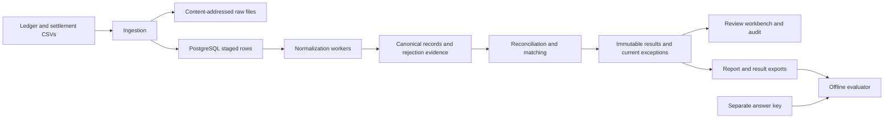

# Architecture

`src/reconciliation/` contains separate modules for ingestion, normalization, matching, exception publication, reporting, workbench, generation, and evaluation. Typer exposes operator commands. SQLAlchemy and Psycopg handle transactions, Alembic manages the schema, and RapidFuzz computes reference distance.

- `ingestion.py` captures raw bytes first through the interface in `storage.py`. It stages rows in bounded commits keyed by file ID and CSV record number. Workers can see rows only when extraction completes. Retrying interrupted extraction verifies or recreates the same staging keys.
- `normalization.py` claims bounded batches with PostgreSQL `FOR UPDATE SKIP LOCKED`. The transaction holds the claim through canonical writes and staging completion. PostgreSQL releases claims on disconnect. Retrying after commit sees completed rows. The worker retries eligible transient failures four times with exponential backoff and reports exhausted failures.
- `reconcile.py` uses a per-scope, per-business-date advisory transaction lock. Input manifests, rules, matcher version, scope, date, and cutoff identify a context. A replay recomputes the business hash and compares it with the stored hash. New contexts publish atomically. An older cutoff can publish a historical snapshot while the current pointer remains on the latest cutoff. At equal cutoffs a newly published context becomes current.
- PostgreSQL constraints enforce one ledger and one settlement per result assignment and require the correct record type at both endpoints. Current anomaly state and human review state are separate. Automatic updates preserve human review. Database triggers reject application updates, deletes, and truncation of audit history.
- In isolated mode the matcher image uses a build allowlist and mounts only rules and exports. A separate PostgreSQL role reads canonical and quality views and writes publications. The role cannot read raw staging payloads. The evaluator reads exported JSON and its private answer key without a database connection. Use the restricted runner where the host trust assumption does not hold.

See [business rules](business-rules.md) for matching and report populations. The [verification evidence](../artifacts/evidence/README.md) includes runtime, concurrency, recovery, evaluation, and replay results.
